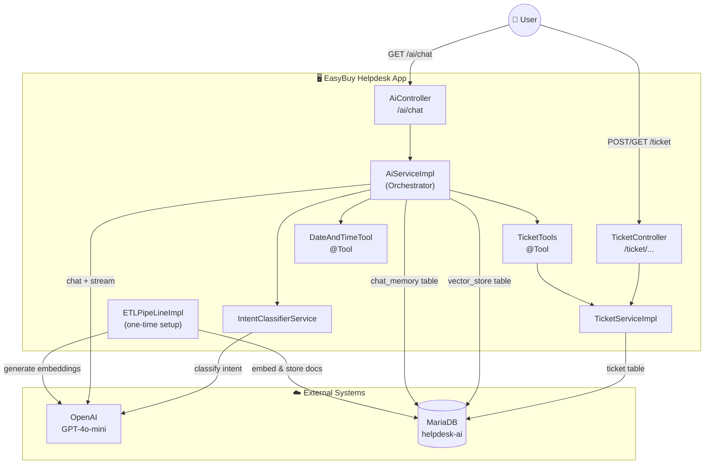
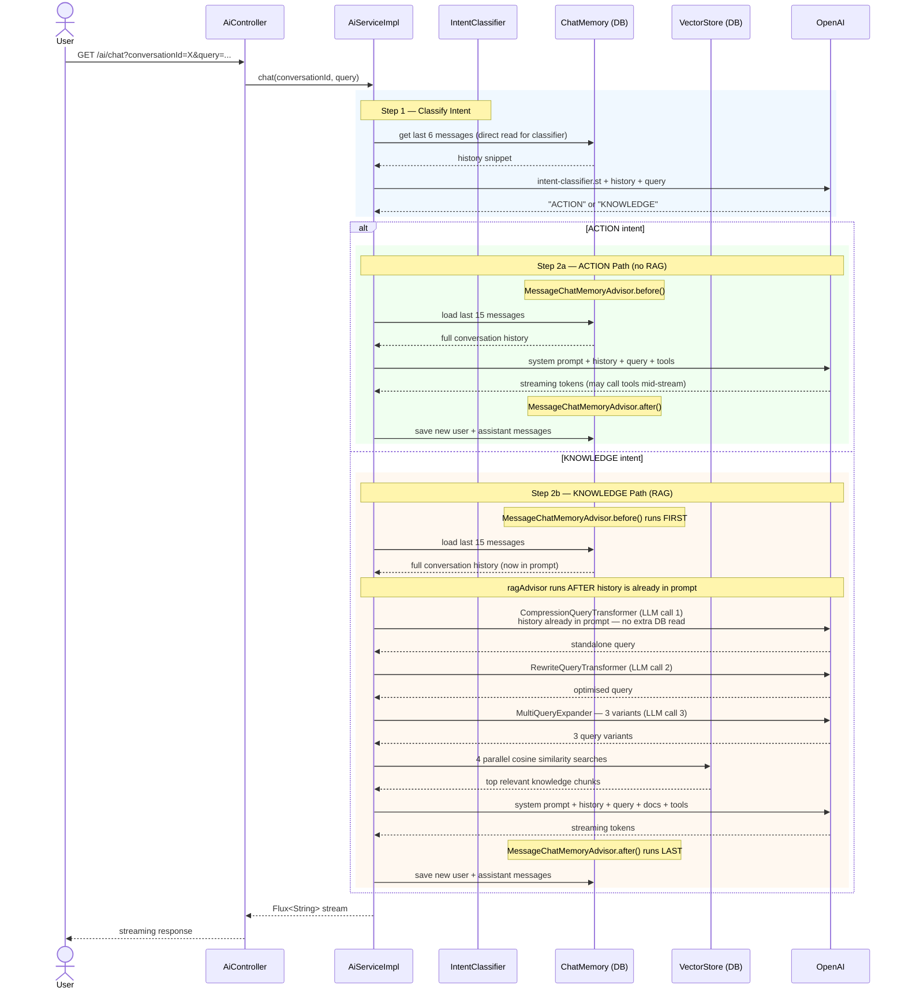
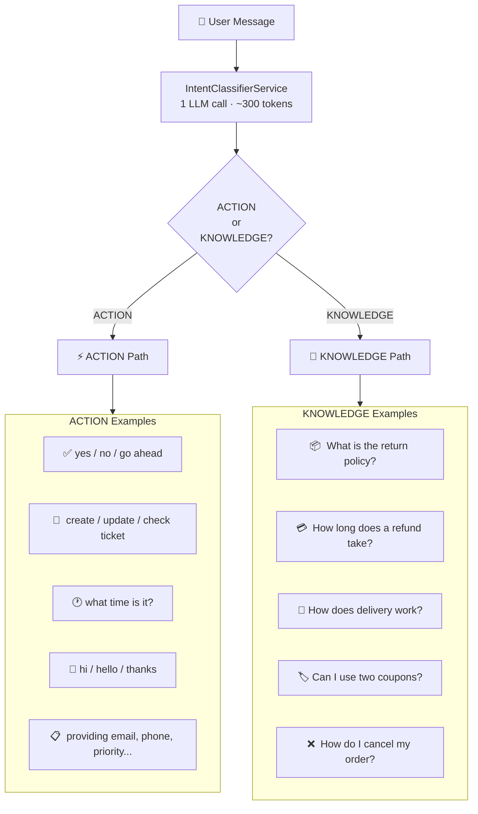
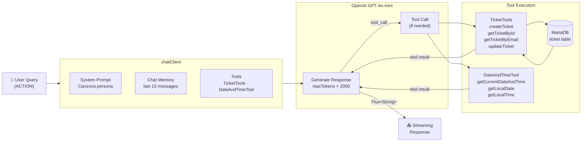
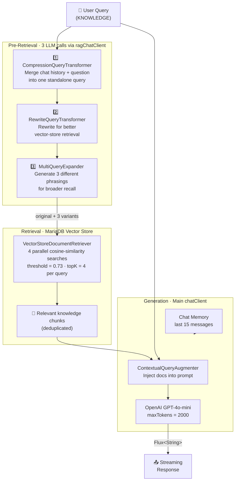
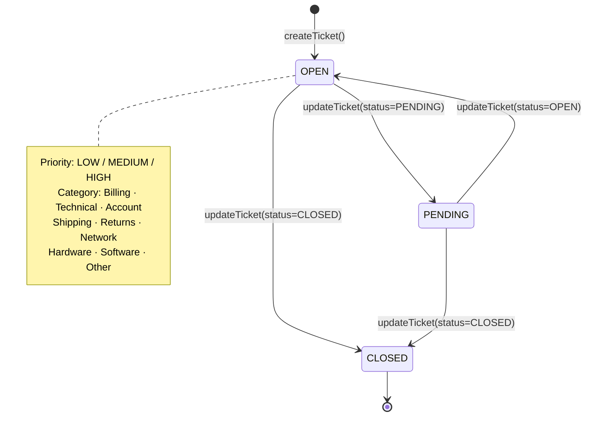
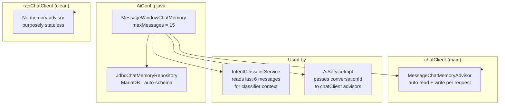
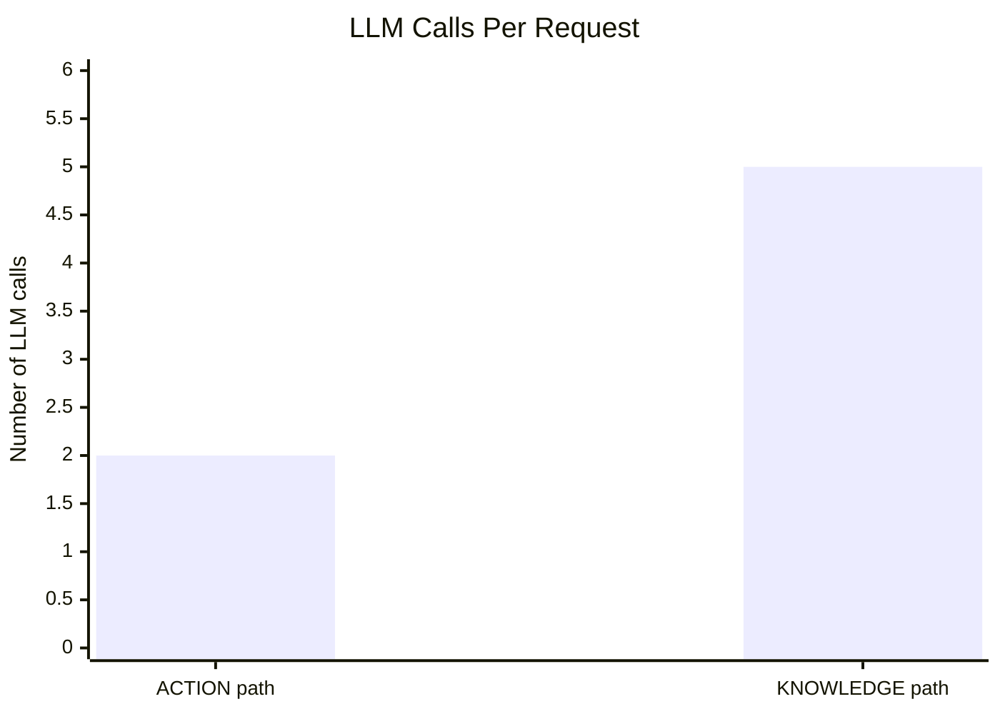

# EasyBuy Helpdesk — Architecture & Flow

> AI-powered customer support built with **Spring Boot 4** · **Spring AI 2** · **OpenAI GPT-4o-mini** · **MariaDB**

---

## 1. High-Level System Overview

---

## 2. Full Request Flow (Sequence Diagram)

> **Key insight — advisor execution order:**
> `MessageChatMemoryAdvisor` is registered before `ragAdvisor`, so it always runs first on the request side. This means when `CompressionQueryTransformer` executes inside `ragAdvisor`, the conversation history is **already loaded into the prompt** — no second database read happens. The DB is only touched **once for reading** and **once for writing** per request.

---

## 3. Intent Routing

---

## 4. ACTION Path — Detail

---

## 5. KNOWLEDGE Path — RAG Pipeline Detail

---

## 6. Ticket Lifecycle

---

## 7. ETL Pipeline — One-Time Knowledge Base Setup

```mermaid
flowchart LR
    subgraph DOCS["📁 /templates/*.md  (12 knowledge documents)"]
        D1["00 EasyBuy Overview"]
        D2["01 Shipping & Delivery"]
        D3["02 Returns & Replacements"]
        D4["03 Payments & Refunds"]
        D5["04 Customer FAQ"]
        D6["... 7 more docs"]
    end

    subgraph EXTRACT["Step 1 · EXTRACT"]
        MR["MarkdownDocumentReader\nhorizontal rules → document splits"]
    end

    subgraph TRANSFORM["Step 2 · TRANSFORM"]
        SP["TokenTextSplitter\nchunkSize = 800 tokens\nminChunkChars = 400"]
    end

    subgraph LOAD["Step 3 · LOAD"]
        OAI["OpenAI Embeddings API\n1536-dimension vectors"]
        VS[("MariaDB\nvector_store table")]
    end

    DOCS --> MR --> SP --> OAI --> VS

    VS -.->|"queried at runtime\nby RAG pipeline"| RAG["🧠 KNOWLEDGE Path"]
```

---

## 8. Chat Memory Architecture

---

## 9. LLM Call Budget Per Request

| Path | LLM Calls | Breakdown |
|---|---|---|
| **ACTION** | **2** | 1 intent classifier + 1 main chat |
| **ACTION + tool** | **3** | 1 intent classifier + 1 main chat + 1 tool-call round-trip |
| **KNOWLEDGE** | **5** | 1 intent classifier + 1 compress + 1 rewrite + 1 expand + 1 main chat |
| **KNOWLEDGE + tool** | **6** | All of above + 1 tool-call round-trip |

> The `ragAdvisor` is built **once at startup** (`@PostConstruct`) and reused — no object construction cost per request.

---

## 10. Key Files Reference

| File | Role |
|---|---|
| `AiController.java` | HTTP entry point — `GET /ai/chat` |
| `TicketController.java` | REST CRUD — bypasses AI entirely |
| `AiServiceImpl.java` | Core orchestrator — routing, RAG advisor, all ChatClient calls |
| `IntentClassifierService.java` | Classifies every message into ACTION or KNOWLEDGE |
| `AiConfig.java` | Spring beans: `chatClient`, `ragChatClient`, `ChatMemory` |
| `TicketTools.java` | 4 `@Tool` methods the AI invokes for ticket CRUD |
| `DateAndTimeTool.java` | 3 `@Tool` methods for date/time (IST) |
| `TicketServiceImpl.java` | Pure ticket CRUD logic, shared by tools + REST controller |
| `ETLPipeLineImpl.java` | One-time knowledge base loader |
| `canzova-system-prompt.st` | AI agent persona + all behaviour rules |
| `intent-classifier.st` | Prompt template for ACTION vs KNOWLEDGE classification |
| `multiQueryExpander.st` | Prompt template for generating 3 RAG query variants |
| `templates/*.md` | 12 EasyBuy knowledge base documents |
