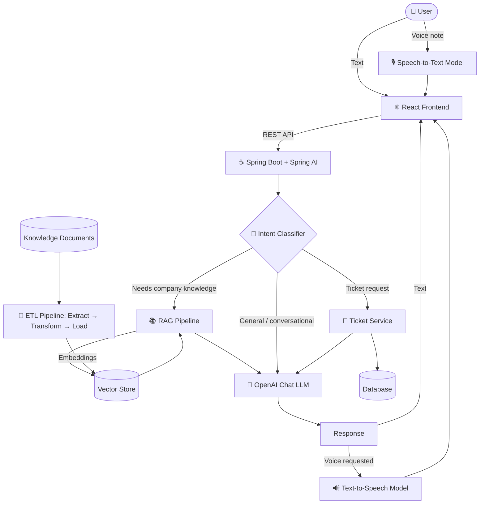

# ⚡ EasyBuy Help Desk AI

> **Meet Canzova**, an AI-powered customer support agent for e-commerce.
> Chat or talk to an intelligent support agent, get answers grounded in your own knowledge base, and raise or track support tickets, all in one place.


---

## 📖 Overview

**EasyBuy Help Desk AI** is a full-stack customer support platform for **EasyBuy**, an e-commerce marketplace. At its centre is **Canzova**, an AI support agent that can answer questions about orders, payments, deliveries, returns and refunds, and can even **create support tickets on the customer's behalf** straight from the conversation.

What makes it different from a basic chatbot:

- 🧠 **Intent-aware routing.** Every message is classified first. Only questions that actually need company knowledge go through the RAG pipeline; everything else takes the faster, cheaper normal-chat path.
- 📚 **Retrieval-Augmented Generation (RAG).** Answers about policies, returns and refunds are grounded in your own documents rather than the model's guesses.
- 🎙️ **Voice in, voice out.** Customers can type or speak, and read or listen to the replies.
- 🎫 **Built-in ticketing.** Create tickets via the form or by simply chatting with Canzova, then look them up by ID or email.

---

## 🖼️ Screenshots

### AI Support Chat

| Welcome screen | Intent-based reply |
|:---:|:---:|
|  |  |

| Thinking indicator | Voice recording |
|:---:|:---:|
|  |  |

### Voice note → text → ticket, all in chat

| Voice note transcribed | Ticket created through chat |
|:---:|:---:|
|  |  |

### Ticket management

| Create a ticket | Lookup a ticket |
|:---:|:---:|
|  |  |


---

## ✨ Features

### 🤖 Conversational AI Support (Canzova)
- Friendly, context-aware support agent powered by an **OpenAI LLM** through **Spring AI**.
- Handles questions on orders, payments, delivery tracking, returns and refunds.
- Multi-turn conversations, with a **New chat** button to start fresh at any time.
- Animated typing indicator while the agent is responding.

### 🧭 Intent Classifier
- Each user message is first run through an **intent classifier**.
- **Knowledge-based intents** (e.g. return policy, refund rules) are routed through the **RAG pipeline**.
- **General or conversational intents** (greetings, small talk, ticket creation flow) skip retrieval and go straight to the LLM.
- Result: lower latency, lower token cost and fewer irrelevant retrievals.

### 📚 RAG (Retrieval-Augmented Generation)
- Relevant knowledge chunks are retrieved from a vector store and injected into the prompt.
- Answers stay grounded in EasyBuy's own documentation and policies.
- Triggered **only when the classified intent needs it**.

### 🔄 ETL Pipeline
- An **Extract → Transform → Load** pipeline ingests source documents, cleans and chunks them, generates embeddings and loads them into the vector store.
- Keeps the knowledge base easy to update without touching application code.

### 🎙️ Voice Support (Speech-to-Text and Text-to-Speech)
- **Speech-to-Text:** record a voice note in the browser; it is transcribed and shown in the chat with a *Voice note* badge and duration.
- **Text-to-Speech:** Canzova can speak her replies aloud (headphones button).
- STT and TTS each use a **dedicated model**, separate from the chat LLM.
- Users can mix and match: **text in / text out, voice in / text out, text in / voice out, or voice in / voice out.**

### 🎫 Ticket Management
- **Create via chat:** Canzova collects the details (email, contact number, issue, category, priority), **confirms them with the user**, and only then creates the ticket.
- **Create via form:** a classic form with email, contact number, category, priority (Low / Medium / High) and a detailed issue description.
- **Lookup tickets:** search by **Ticket ID** or **registered email**, and see priority, status, category, contact details and created/updated timestamps.

### 🎨 UI / UX
- Clean, modern, responsive interface.
- Light / dark mode toggle.
- Separate tabs for **AI Support**, **Create Ticket** and **Lookup Ticket**.

---

## 🏗️ Architecture



### Request flow

1. The user sends a **text** message or a **voice note** (transcribed by the STT model).
2. The **intent classifier** inspects the message.
3. Depending on the intent:
   - **Needs knowledge** → relevant chunks are retrieved via **RAG**, then the LLM answers using that context.
   - **General chat** → the LLM answers directly.
   - **Ticket-related** → Canzova gathers details, confirms, and creates the ticket.
4. The reply is returned as **text**, and optionally converted to **speech** by the TTS model.

---

## 🛠️ Tech Stack

| Layer | Technology |
|---|---|
| **Backend** | Java, Spring Boot, Spring AI |
| **Chat LLM** | OpenAI |
| **RAG** | Spring AI + Vector Store |
| **Data ingestion** | Custom ETL pipeline (Extract, Transform, Load) |
| **Speech-to-Text** | Dedicated STT model |
| **Text-to-Speech** | Dedicated TTS model |
| **Frontend** | React.js *(vibe-coded 🎨)* |
| **Persistence** | Database for tickets |

> 💡 **Note:** The frontend was entirely vibe-coded with AI assistance. The focus of this project is the backend AI architecture: intent classification, conditional RAG, ETL and voice pipelines.

---

## 📁 Project Structure

```
helpdesk/
├── backend/                # Spring Boot + Spring AI application
├── frontend/               # React.js application
├── docs/
│   └── screenshots/        # README images
└── README.md
```

> Adjust folder names above to match your repository layout.

---

## 🚀 Getting Started

### Prerequisites

- Java 17+ (or the version your project targets)
- Maven or Gradle
- Node.js 18+ and npm
- An **OpenAI API key**
- A running vector store and database (as configured in your `application.properties`)

### 1. Clone the repository

```bash
git clone https://github.com/Canzova/helpdesk.git
cd helpdesk
```

### 2. Configure the backend

Set your credentials in `application.properties` (or as environment variables):

```properties
spring.ai.openai.api-key=YOUR_OPENAI_API_KEY
# Add your vector store / database configuration here
```

> ⚠️ Never commit real API keys. Use environment variables or a local, git-ignored config file.

### 3. Run the backend

```bash
cd backend
./mvnw spring-boot:run
```

### 4. Run the ETL pipeline

Load your knowledge documents into the vector store so RAG has something to retrieve. *(Add the exact command or endpoint you use here.)*

### 5. Run the frontend

```bash
cd frontend
npm install
npm start
```

The app will be available at `http://localhost:3000`.

---

## 💬 Example Conversations

**Knowledge question → goes through RAG**
> *"What is your return policy for electronics?"*

**General question → normal LLM path**
> *"hi, tell me something about EasyBuy"*

**Ticket creation → guided, with confirmation**
> *"My order payment was deducted but the status still shows pending."*
> Canzova collects your email, contact number, priority and category, confirms the details, then creates the ticket.

**Voice note**
> 🎙️ *"I want to raise a ticket because my order is more than 12 weeks old and still not delivered."*

---

## 🗺️ Roadmap

- [ ] Ticket status updates and agent replies
- [ ] User authentication
- [ ] Multi-language voice support
- [ ] Streaming responses
- [ ] Admin dashboard for ticket management
- [ ] Analytics on intents and resolution rates

---

## 🤝 Contributing

Contributions, issues and feature requests are welcome! Feel free to open an issue or submit a pull request.

---

**Built with ☕ Spring Boot, 🧠 Spring AI and ⚛️ React**

If you found this project interesting, consider giving it a ⭐