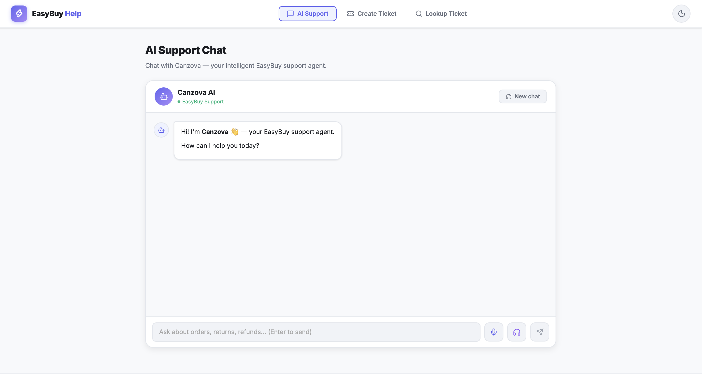
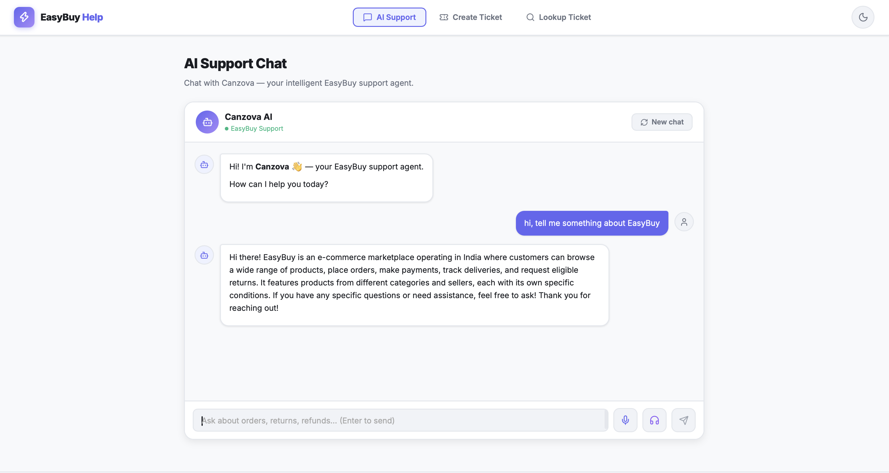
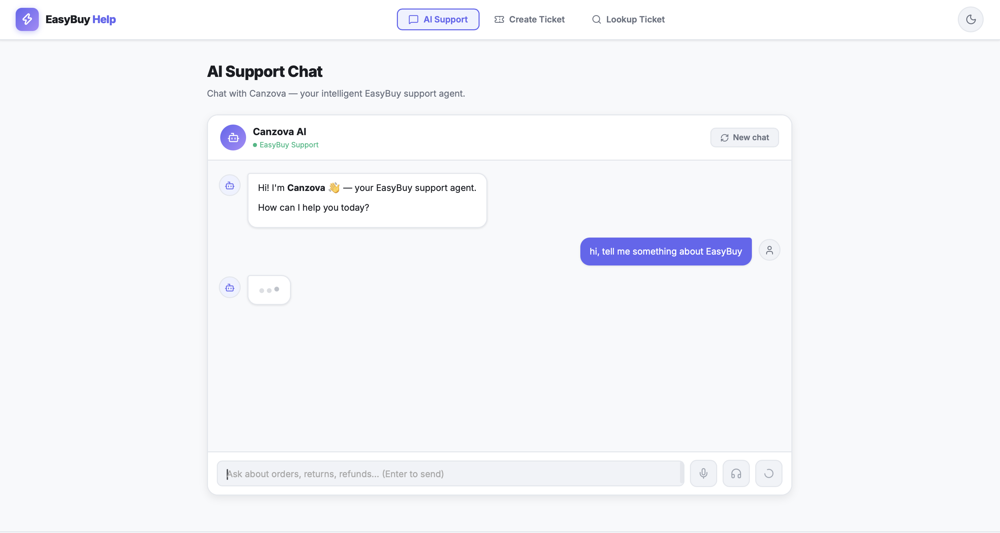
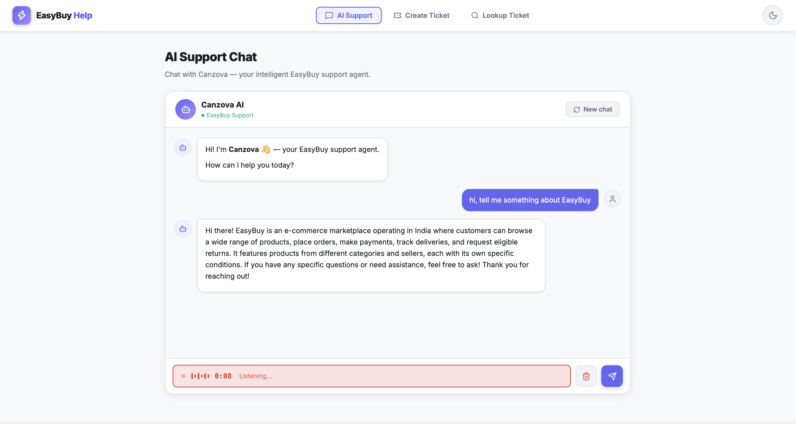
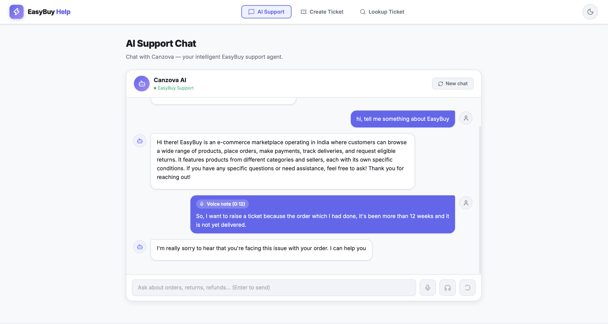
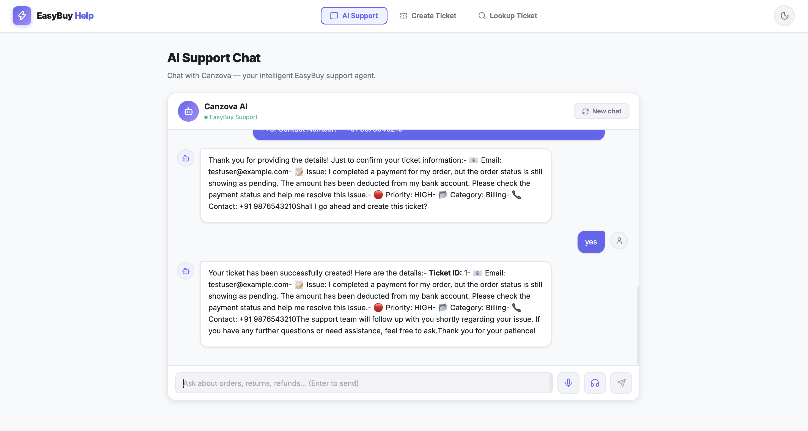
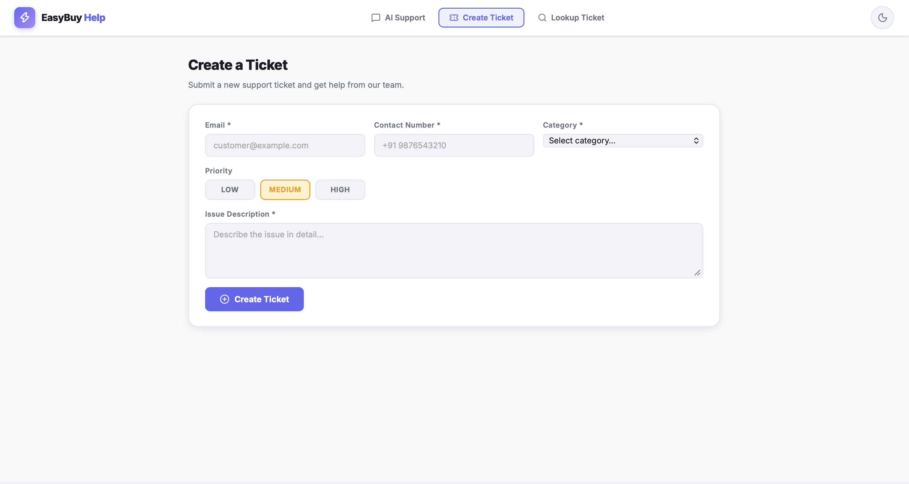
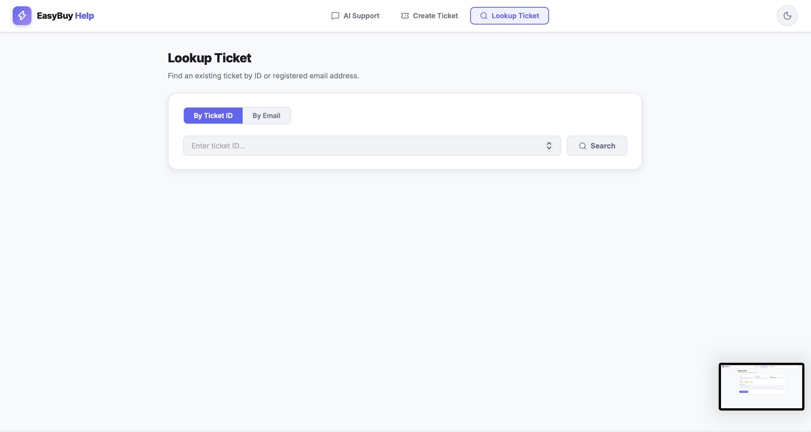
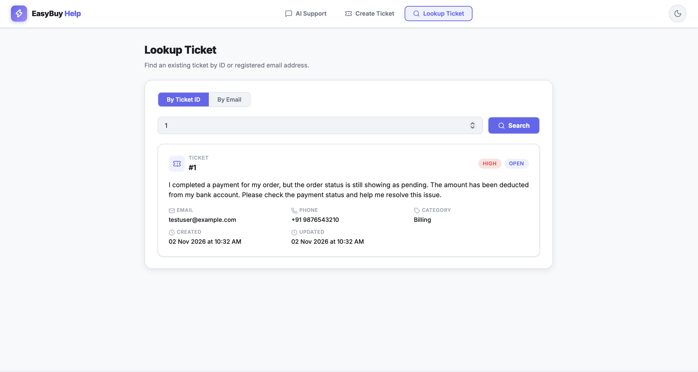
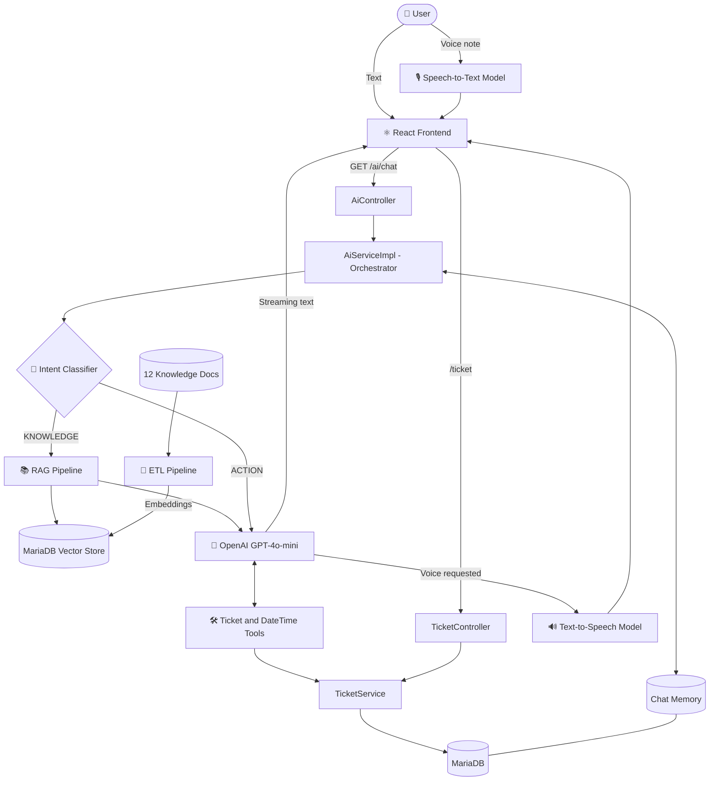

# ⚡ EasyBuy Help Desk AI

> **Meet Canzova**, an AI-powered customer support agent for e-commerce.
> Chat or talk to an intelligent support agent, get answers grounded in your own knowledge base, and raise or track support tickets, all in one place.


---

## 📖 Overview

**EasyBuy Help Desk AI** is a full-stack customer support platform for **EasyBuy**, an e-commerce marketplace operating in India. At its centre is **Canzova**, an AI support agent that answers questions about orders, payments, deliveries, returns and refunds, and can **create, look up and update support tickets** straight from the conversation.

What makes it different from a basic chatbot:

- 🧠 **Intent-aware routing.** Every message is classified as `ACTION` or `KNOWLEDGE` first. Only knowledge questions go through the RAG pipeline; everything else takes the faster, cheaper normal-chat path.
- 📚 **Retrieval-Augmented Generation (RAG).** Answers about policies, returns and refunds are grounded in EasyBuy's own documents rather than the model's guesses.
- 🎙️ **Voice in, voice out.** Customers can type or speak, and read or listen to the replies.
- 🎫 **Built-in ticketing.** Create tickets via the form or just by chatting with Canzova, then look them up by ID or email.
- ⚡ **Streaming responses** and **persistent chat memory** backed by MariaDB.

---

## 🖼️ Screenshots

### AI Support Chat

| Welcome screen | Intent-based reply |
|:---:|:---:|
|  |  |

| Thinking indicator | Voice recording |
|:---:|:---:|
|  |  |

### Voice note → text → ticket, all in chat

| Voice note transcribed | Ticket created through chat |
|:---:|:---:|
|  |  |

### Ticket management

| Create a ticket | Lookup a ticket |
|:---:|:---:|
|  |  |



---

## ✨ Features

### 🤖 Conversational AI Support (Canzova)
- Friendly, context-aware support agent powered by **OpenAI GPT-4o-mini** through **Spring AI**.
- Handles questions on orders, payments, delivery tracking, returns and refunds.
- **Streaming responses** (`Flux<String>`) for a fast, live-typing feel.
- **Persistent chat memory:** the last 15 messages per conversation are stored in MariaDB.
- **New chat** button to start a fresh conversation at any time.

### 🧭 Intent Classifier
- Each user message is first run through an **intent classifier** (one lightweight LLM call that also sees the last few messages for context).
- **`KNOWLEDGE`** → policy and FAQ questions such as *"What is the return policy?"* go through the **RAG pipeline**.
- **`ACTION`** → greetings, confirmations (*"yes"*), ticket requests, details like email or phone, and date/time questions skip retrieval and go straight to the LLM and its tools.
- Result: lower latency, lower token cost and no irrelevant retrievals.

### 📚 RAG (Retrieval-Augmented Generation)
- Built with Spring AI's modular RAG components on top of the **MariaDB vector store**.
- **Pre-retrieval:** the query is compressed with chat history into a standalone question, rewritten for better retrieval, and expanded into 3 alternative phrasings.
- **Retrieval:** parallel cosine-similarity searches (similarity threshold 0.73, top-K 4 per query), with results deduplicated.
- **Generation:** the retrieved chunks are injected into the prompt so Canzova answers from EasyBuy's actual documentation.
- Triggered **only when the classified intent is `KNOWLEDGE`**.

### 🔄 ETL Pipeline
A one-time pipeline that builds the knowledge base from **12 EasyBuy markdown documents** (overview, shipping and delivery, returns and replacements, payments and refunds, customer FAQ, and more):

1. **Extract:** `MarkdownDocumentReader` reads the documents and splits them on horizontal rules.
2. **Transform:** `TokenTextSplitter` chunks the text (800 tokens per chunk).
3. **Load:** OpenAI embeddings (1536 dimensions) are generated and stored in MariaDB's `vector_store` table.

### 🛠️ AI Tools (function calling)
Canzova can take real actions through Spring AI `@Tool` methods:

| Tool | What it does |
|---|---|
| `createTicket` | Creates a new support ticket after the user confirms the details |
| `getTicketById` | Looks up a ticket by its ID |
| `getTicketByEmail` | Finds tickets by registered email |
| `updateTicket` | Updates ticket status or details |
| `DateAndTimeTool` | Provides current date and time (IST) |

### 🎙️ Voice Support (Speech-to-Text and Text-to-Speech)
- **Speech-to-Text:** record a voice note in the browser; it is transcribed and shown in the chat with a *Voice note* badge and duration.
- **Text-to-Speech:** Canzova can speak her replies aloud (headphones button).
- STT and TTS each use a **dedicated model**, separate from the chat LLM.
- Mix and match: **text → text, voice → text, text → voice, or voice → voice.**

### 🎫 Ticket Management
- **Create via chat:** Canzova collects email, contact number, issue, category and priority, **confirms them with the user**, and only then creates the ticket.
- **Create via form:** email, contact number, category, priority (Low / Medium / High) and a detailed description.
- **Lookup:** search by **Ticket ID** or **registered email** and see priority, status, category, contact details and created/updated timestamps.
- **Statuses:** `OPEN` → `PENDING` → `CLOSED`
- **Categories:** Billing, Technical, Account, Shipping, Returns, Network, Hardware, Software, Other.

### 🎨 UI / UX
- Clean, modern, responsive React interface *(vibe-coded 🎨)*.
- Light / dark mode toggle.
- Separate tabs for **AI Support**, **Create Ticket** and **Lookup Ticket**.

---

## 🏗️ Architecture



### Request flow

1. The user sends a **text** message or a **voice note** (transcribed by the STT model).
2. The **intent classifier** labels it `ACTION` or `KNOWLEDGE`.
3. **`KNOWLEDGE`** → query compression, rewriting and multi-query expansion → vector search → grounded answer.
4. **`ACTION`** → straight to the LLM with chat memory and tools (ticket CRUD, date/time).
5. The reply streams back as **text**, and can optionally be converted to **speech** by the TTS model.

### LLM calls per request

| Path | LLM calls |
|---|---|
| `ACTION` | 2 (classifier + chat) |
| `ACTION` + tool | 3 |
| `KNOWLEDGE` | 5 (classifier + compress + rewrite + expand + chat) |
| `KNOWLEDGE` + tool | 6 |

📄 For sequence diagrams, memory design and the full file reference, see **[ARCHITECTURE.md](ARCHITECTURE.md)**.

---

## 🛠️ Tech Stack

| Layer | Technology |
|---|---|
| **Backend** | Java, Spring Boot 4, Spring AI 2 |
| **Chat LLM** | OpenAI GPT-4o-mini |
| **Embeddings** | OpenAI Embeddings (1536 dimensions) |
| **RAG** | Spring AI modular RAG + MariaDB vector store |
| **Data ingestion** | Custom ETL pipeline (Extract, Transform, Load) |
| **Chat memory & tickets** | MariaDB |
| **Speech-to-Text** | Dedicated STT model |
| **Text-to-Speech** | Dedicated TTS model |
| **Frontend** | React.js *(vibe-coded 🎨)* |
| **Build tool** | Maven |

> 💡 The frontend was entirely vibe-coded with AI assistance. The focus of this project is the backend AI architecture: intent classification, conditional RAG, tool calling, ETL and voice pipelines.

---

## 📁 Project Structure

```
helpdesk/
├── .mvn/wrapper/           # Maven wrapper
├── src/                    # Spring Boot backend (controllers, services, tools, config, prompts, knowledge docs)
├── frontend/               # React.js application
├── docs/
│   └── screenshots/        # README images
├── ARCHITECTURE.md         # Detailed architecture and flow diagrams
├── pom.xml
└── README.md
```

---

## 🚀 Getting Started

### Prerequisites

- Java (version defined in `pom.xml`)
- Node.js 18+ and npm
- **MariaDB** with a database for the app (e.g. `helpdesk-ai`)
- An **OpenAI API key**

### 1. Clone the repository

```bash
git clone https://github.com/Canzova/helpdesk.git
cd helpdesk
```

### 2. Configure the backend

Set your credentials in `src/main/resources/application.properties` (or as environment variables):

```properties
spring.ai.openai.api-key=YOUR_OPENAI_API_KEY
spring.datasource.url=jdbc:mariadb://localhost:3306/helpdesk-ai
spring.datasource.username=YOUR_DB_USER
spring.datasource.password=YOUR_DB_PASSWORD
```

> ⚠️ Never commit real API keys or passwords. Use environment variables or a git-ignored config file.

### 3. Run the backend

```bash
./mvnw spring-boot:run
```

### 4. Load the knowledge base (ETL)

Run the ETL pipeline once so the 12 knowledge documents are embedded into the vector store. Without this step, RAG has nothing to retrieve.

### 5. Run the frontend

```bash
cd frontend
npm install
npm run dev   # or npm start, depending on your setup
```

---

## 💬 Example Conversations

**Knowledge question → goes through RAG**
> *"What is your return policy?"*

**General question → normal LLM path**
> *"hi, tell me something about EasyBuy"*

**Ticket creation → guided, with confirmation**
> *"I completed a payment but my order status still shows pending."*
> Canzova collects your email, contact number, priority and category, confirms the details, then creates the ticket.

**Voice note**
> 🎙️ *"I want to raise a ticket because my order is more than 12 weeks old and still not delivered."*

---

## 🗺️ Roadmap

- [ ] User authentication
- [ ] Multi-language voice support
- [ ] Admin dashboard for ticket management
- [ ] Analytics on intents and resolution rates

---

## 🤝 Contributing

Contributions, issues and feature requests are welcome! Feel free to open an issue or submit a pull request.

---


**Built with ☕ Spring Boot, 🧠 Spring AI and ⚛️ React**

If you found this project interesting, consider giving it a ⭐