# EasyBuy Helpdesk — Architecture & Flow

> AI-powered customer support built with **Spring Boot 4** · **Spring AI 2** · **OpenAI GPT-4o-mini** · **MariaDB**

---

## 1. High-Level System Overview

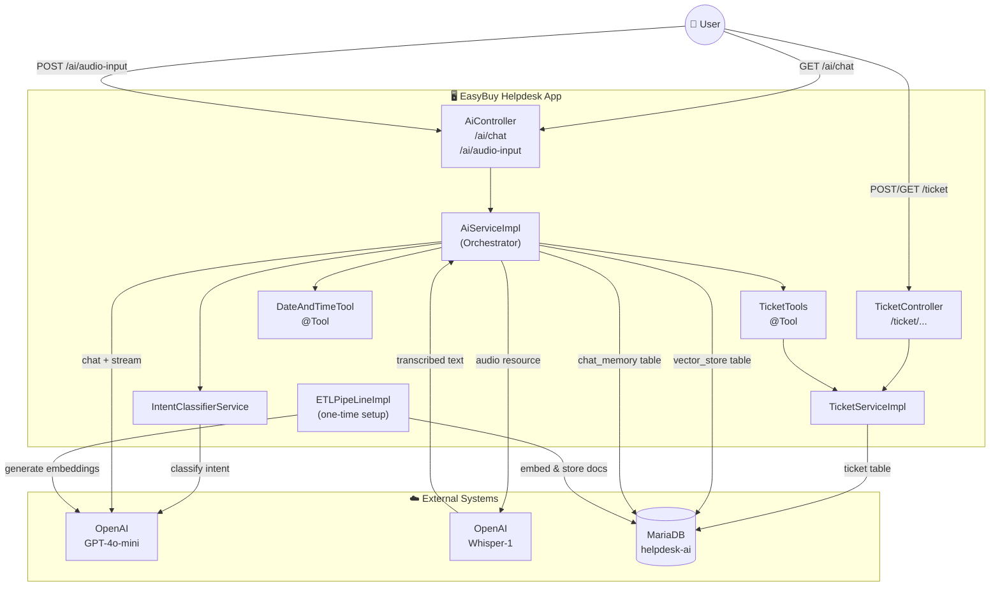

---

## 2. Full Request Flow (Sequence Diagram)

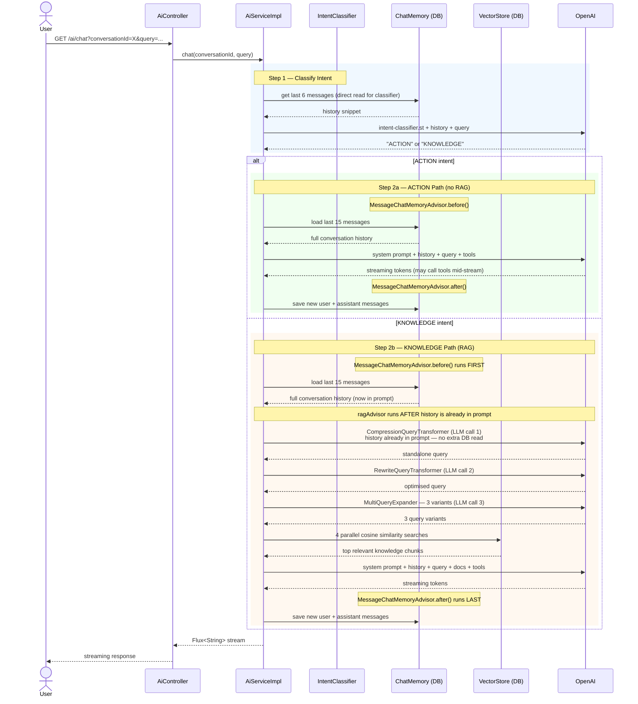

> **Key insight — advisor execution order:**
> `MessageChatMemoryAdvisor` is registered before `ragAdvisor`, so it always runs first on the request side. This means when `CompressionQueryTransformer` executes inside `ragAdvisor`, the conversation history is **already loaded into the prompt** — no second database read happens. The DB is only touched **once for reading** and **once for writing** per request.

---

## 3. Intent Routing

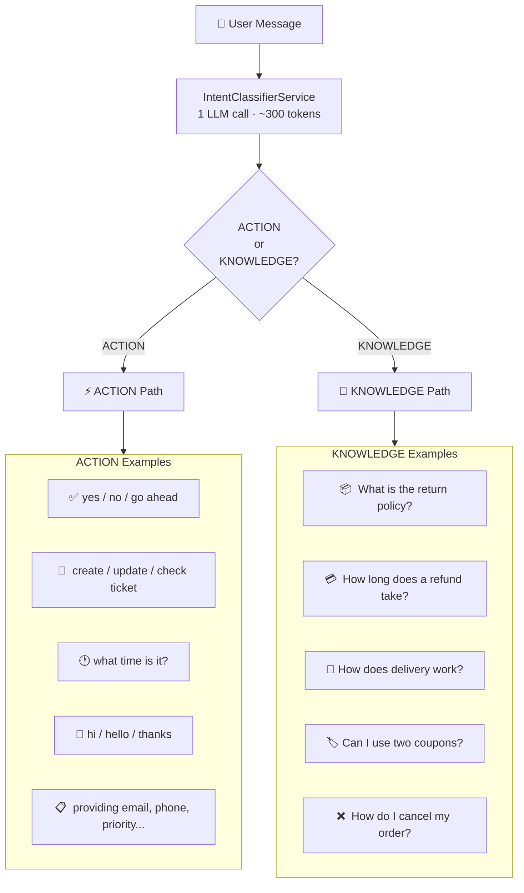

---

## 4. ACTION Path — Detail

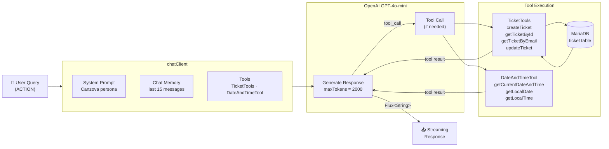

---

## 5. KNOWLEDGE Path — RAG Pipeline Detail

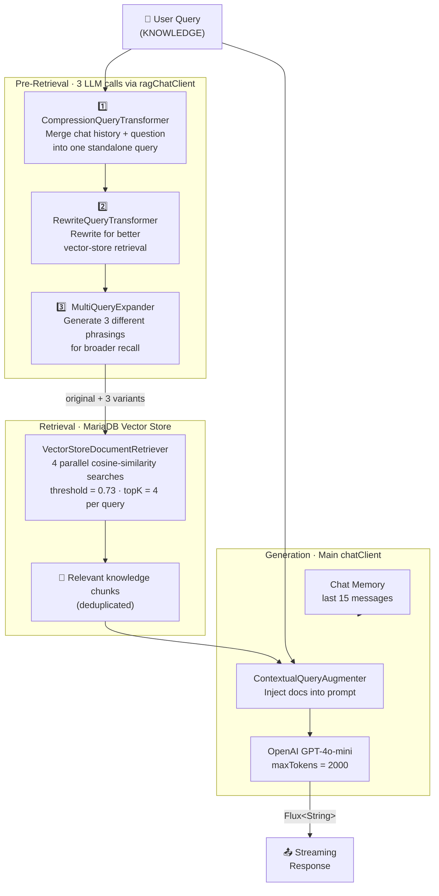

---

## 6. Ticket Lifecycle

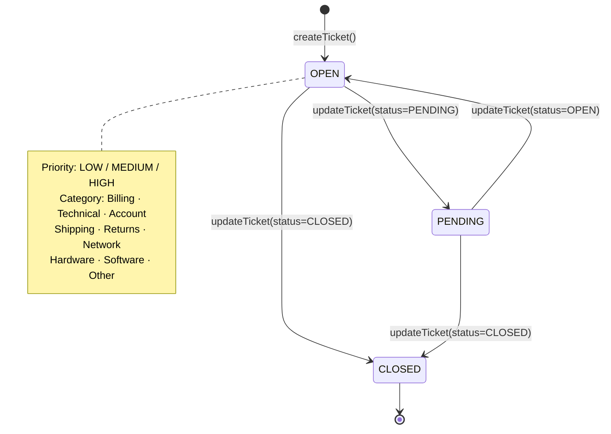

---

## 7. ETL Pipeline — One-Time Knowledge Base Setup


---

## 8. Chat Memory Architecture

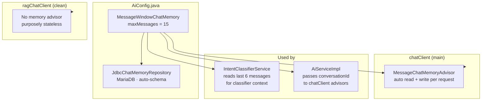

---

## 9. LLM Call Budget Per Request

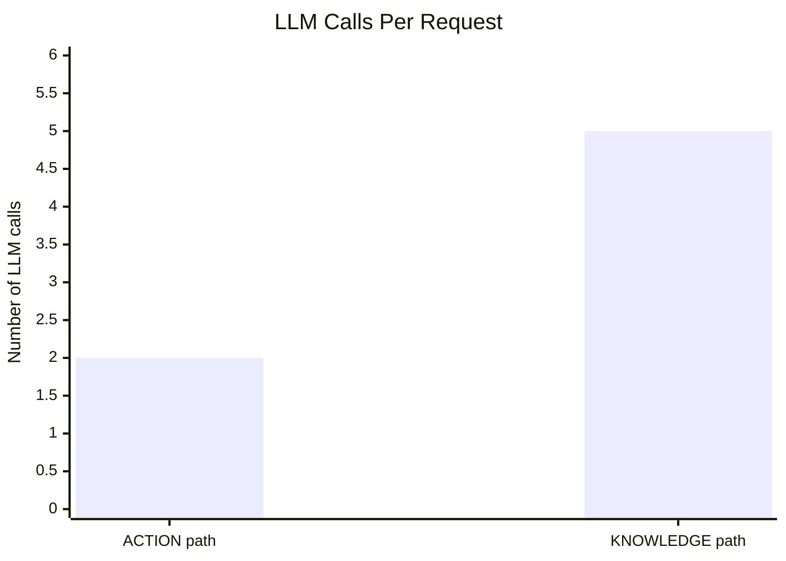

| Path | LLM Calls | Breakdown |
|---|---|---|
| **ACTION** | **2** | 1 intent classifier + 1 main chat |
| **ACTION + tool** | **3** | 1 intent classifier + 1 main chat + 1 tool-call round-trip |
| **KNOWLEDGE** | **5** | 1 intent classifier + 1 compress + 1 rewrite + 1 expand + 1 main chat |
| **KNOWLEDGE + tool** | **6** | All of above + 1 tool-call round-trip |

> The `ragAdvisor` is built **once at startup** (`@PostConstruct`) and reused — no object construction cost per request.

---

## 10. Key Files Reference

| File | Role |
|---|---|
| `AiController.java` | HTTP entry points — `GET /ai/chat` (text) and `POST /ai/audio-input` (voice SSE) |
| `TicketController.java` | REST CRUD — bypasses AI entirely |
| `AiServiceImpl.java` | Core orchestrator — transcription, routing, RAG advisor, ChatClient streaming |
| `IntentClassifierService.java` | Classifies every message into ACTION or KNOWLEDGE |
| `AiConfig.java` | Spring beans: `chatClient`, `ragChatClient`, `ChatMemory` |
| `TicketTools.java` | 4 `@Tool` methods the AI invokes for ticket CRUD |
| `DateAndTimeTool.java` | 3 `@Tool` methods for date/time (IST) |
| `TicketServiceImpl.java` | Pure ticket CRUD logic, shared by tools + REST controller |
| `ETLPipeLineImpl.java` | One-time knowledge base loader |
| `canzova-system-prompt.st` | AI agent persona + all behaviour rules |
| `intent-classifier.st` | Prompt template for ACTION vs KNOWLEDGE classification |
| `multiQueryExpander.st` | Prompt template for generating 3 RAG query variants |
| `templates/*.md` | 12 EasyBuy knowledge base documents |
| `AudioResponseServiceImpl.java` | Text-to-Speech service using `TextToSpeechModel` |
| `../frontend/src/api.js` | API client with `streamChat`, `streamAudioChat` & `sendVoiceToVoiceAudio` |
| `../frontend/src/components/ChatPanel.jsx` | Chat UI with Voice-to-Text & Voice-to-Voice capture and interactive AudioPlayer |

---

## 11. Audio / Voice Input Flow

The voice input pipeline allows users to speak into their microphone in the browser, transcribes the voice using **OpenAI Whisper-1**, immediately presents the transcribed text in the user bubble, and routes the text through the standard AI pipeline (`ACTION` or `KNOWLEDGE`) while streaming the response back via SSE.

### 11.1 Component Flow Diagram

```mermaid
flowchart LR
    MIC["🎙️ User Audio\n(Browser Mic)"] --> REC["MediaRecorder\nBlob (.webm/.mp4/.ogg)"]
    REC --> FETCH["fetch(POST /ai/audio-input)\nmultipart/form-data"]
    FETCH --> CTRL["AiController\n/ai/audio-input"]
    CTRL --> SERV["AiServiceImpl\nchatWithAudio()"]
    SERV --> WSP["OpenAI Whisper-1\nTranscriptionModel.transcribe()"]
    WSP --> TXT["Transcribed String\n(textInput)"]
    TXT --> HDR["Set X-Transcript Header\n(URL-encoded)"]
    HDR --> CHAT["chat(convId, textInput)\nSmart Routing (Action/RAG)"]
    CHAT --> SSE["Flux&lt;String&gt;\nSSE data: tokens"]
```

### 11.2 End-to-End Execution Sequence Diagram

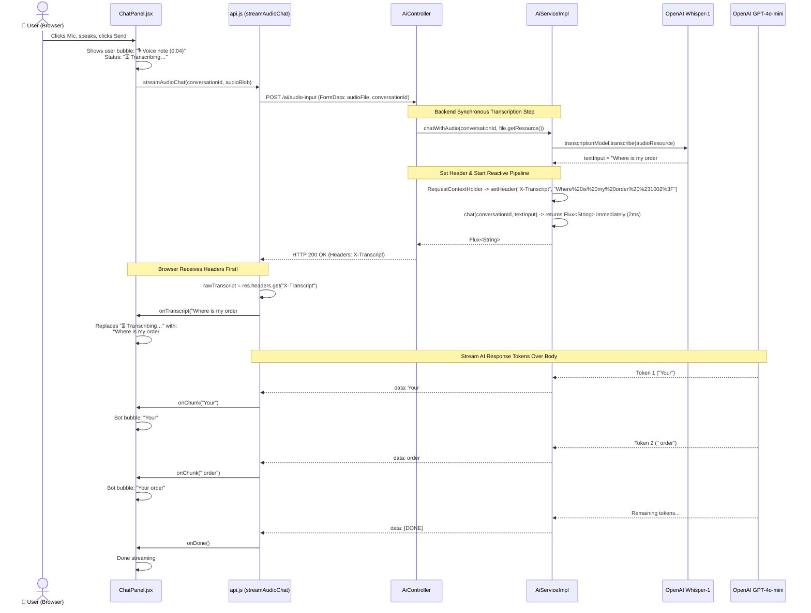

### 11.3 Key Technical Highlights

1. **Why the transcribed text appears before the bot's response**:
   * `chat()` returns a reactive publisher (`Flux<String>`), not a blocking `String`. It finishes in a few milliseconds.
   * In HTTP, headers are sent across the wire **before** the body stream begins.
   * Spring MVC immediately flushes the `X-Transcript` response header to the browser when starting the SSE connection.
   * `fetch()` resolves the moment response headers arrive. The frontend decodes `X-Transcript` and displays the query in the user bubble, while OpenAI is still computing the first token in the background.

2. **Cross-Browser Audio Capture**:
   * `ChatPanel.jsx` probes `MediaRecorder.isTypeSupported()` to pick the optimal audio container (`audio/webm;codecs=opus`, `audio/mp4`, `audio/ogg`).
   * Sends the matching filename extension so OpenAI Whisper correctly decodes the audio.
   * 2-minute safety timeout and auto-release of microphone tracks on completion or cancel.

3. **URL Percent-Encoding (`%20` vs `+`)**:
   * `URLEncoder.encode` in Java defaults to `application/x-www-form-urlencoded` format (which converts spaces to `+`).
   * Backend replaces `+` with `%20`, and frontend decodes with `decodeURIComponent(raw.replace(/\+/g, ' '))`, preserving all whitespace, commas, and special characters.

---

## 12. Voice-to-Voice Chat Flow (`outputType="audio"`)

When the user clicks the dedicated **Voice-to-Voice** button (`Headphones` icon), the full conversational loop operates in voice:

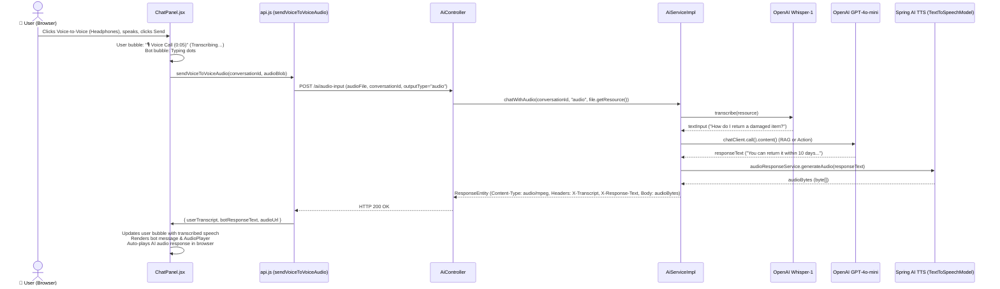

---

## 13. Voice Headers & RequestContextHolder Architecture

### 13.1 Why Use HTTP Headers for Voice Payloads?

In standard REST APIs, text is normally returned in the JSON/text body. In this voice pipeline, however, the response body is already strictly claimed:
* **In Voice-to-Voice (`outputType="audio"`)**: The body is a continuous stream of raw binary MP3 audio bytes (`audio/mpeg`). Injecting JSON or plain text directly into the body would corrupt the audio stream.
* **In Voice-to-Text (`outputType="text"`)**: The body is a streaming Server-Sent Events (SSE) pipe emitting LLM tokens chunk by chunk (`data: token\n\n`).

To transmit metadata without corrupting the body, the system uses custom HTTP response headers as a metadata envelope:

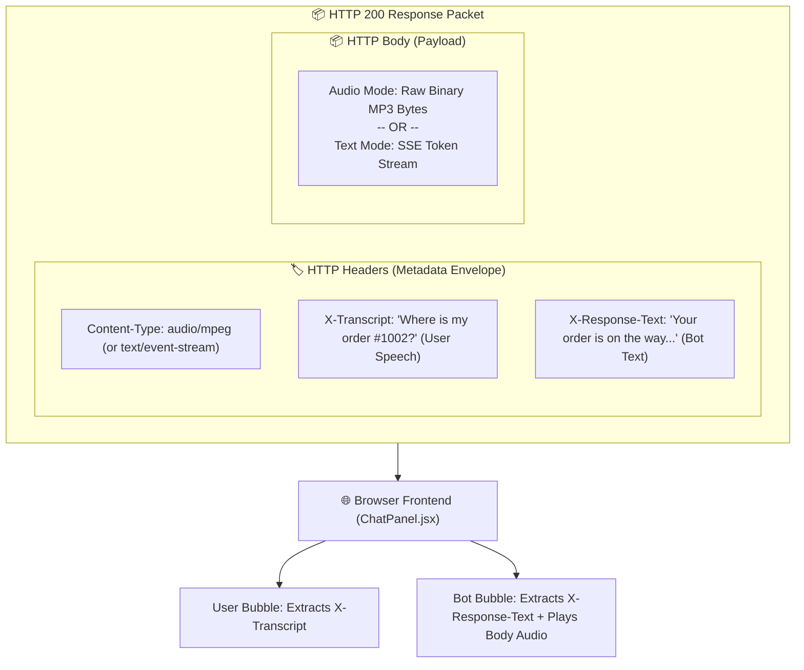

### 13.2 Frontend UI Impact & State Progression

By returning user transcription and bot text in headers, the frontend can transition smoothly between recording, transcribing, and streaming states:

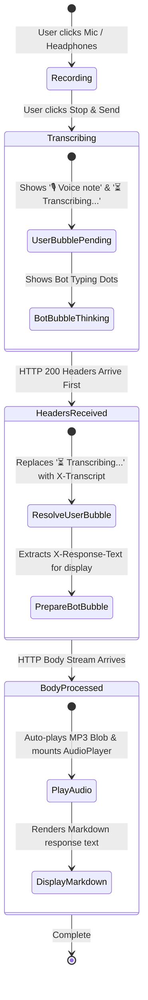

### 13.3 Deep Dive: `RequestContextHolder` Bridge in `AiServiceImpl`

```java
try {
    ServletRequestAttributes attrs = (ServletRequestAttributes) RequestContextHolder.getRequestAttributes();
    if (attrs != null && attrs.getResponse() != null) {
        attrs.getResponse().setHeader("X-Transcript", encodedTranscript);
    }
} catch (Exception e) {
    log.debug("Could not set X-Transcript header: {}", e.getMessage());
}
```

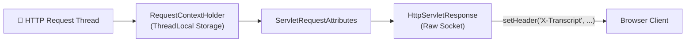

#### Key Technical Principles:
1. **Layer Decoupling**: `AiServiceImpl` is a business service class and does not inject `HttpServletResponse` in its method signatures, keeping business logic cleanly decoupled from the servlet layer.
2. **Immediate Header Emission**: Spring's `RequestContextHolder.getRequestAttributes()` accesses the thread-local HTTP context of the current request. This stamps the `X-Transcript` header directly onto the raw servlet response before reactive or binary data is written to the output stream.
3. **Resilience**: The `try-catch` block guarantees safety: if `AiServiceImpl` is called from a test harness, asynchronous worker, or scheduled background task where no HTTP thread context exists, it logs debug info and completes gracefully without throwing a `NullPointerException`.

